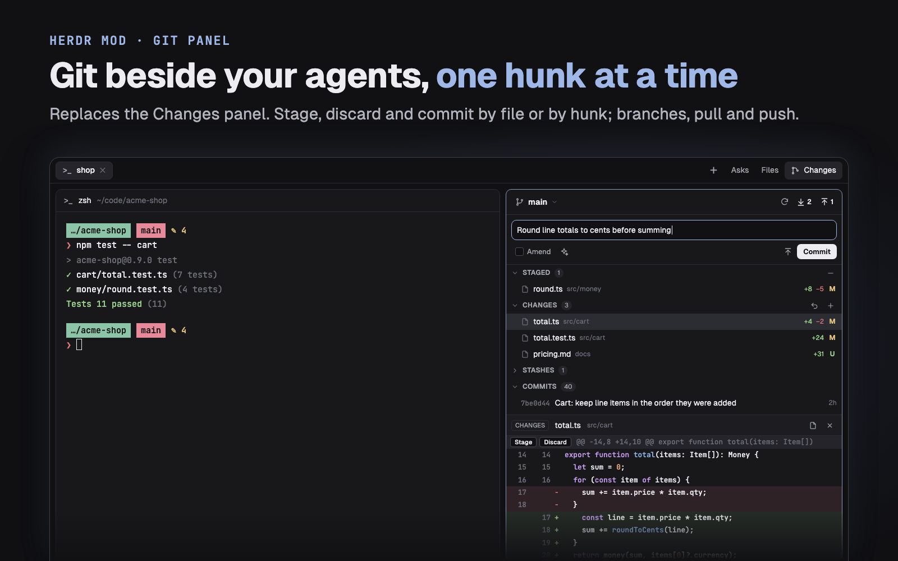
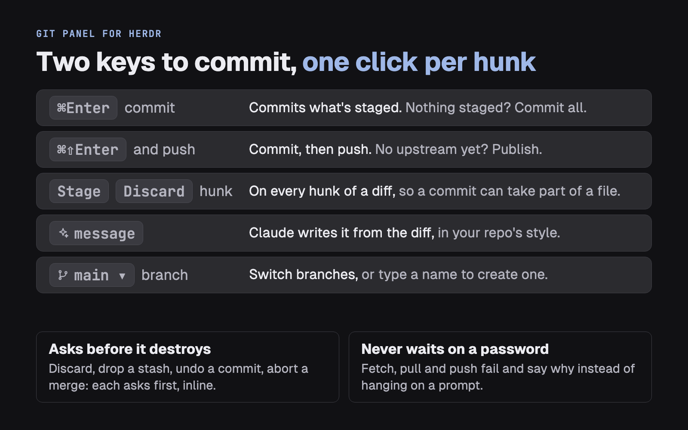

# Git panel for Herdr

A Git panel for the [Herdr](https://herdr.dev) desktop app, replacing the built-in Changes panel. It follows the terminal you're focused on, like Changes does, and adds what you'd expect from an editor's source control view.



## What it does



| | |
|---|---|
| **Staged and unstaged** | Separate **Staged**, **Changes** and **Merge conflicts** lists, with +/− counts. Hover a file to stage, unstage, discard or open it. Section buttons stage, unstage or discard everything. |
| **Hunks** | Click a file to see its diff. Each hunk has **Stage**, **Unstage** or **Discard**, so you can commit part of a file. |
| **Commit** | A multi-line message, ⌘Enter to commit, ⌘⇧Enter to commit and push. With nothing staged, it commits everything (**Commit all**). **Amend** fills in the last message. |
| **Message from Claude** | ✨ writes a message from the staged diff (or all changes) in the style of the repo's recent commits, with `claude -p --model haiku`. Only when you click it. |
| **Branches** | Click the branch name to switch branches (local or remote, with tracking) or create one by typing its name. |
| **Sync** | Fetch, pull (shows how many commits behind) and push (how many ahead). A branch without an upstream gets **Publish**. Network commands never wait for a password prompt: they fail and show why. |
| **Stashes** | Stash everything, including new files; apply, pop or drop a stash; click one to see its diff. |
| **Commits** | The last 40 commits; click one to see its diff. **Undo** on the newest commit (if it isn't pushed yet) is `git reset --soft HEAD~1`, and its message comes back into the box. |
| **Merges and rebases** | A banner while a merge, rebase, cherry-pick or revert is in progress, with **Continue** and **Abort**. Conflicted files get **Ours**, **Theirs** and **Mark resolved**. |
| **Other machines** | Works in spaces on another machine too (git runs there). |

Everything destructive (discard, delete a new file, drop a stash, undo a commit, abort) asks first, inline. With the [Editor](https://github.com/ReidenXerx/herdr-editor) mod installed, files open in it. Files can also be dragged into a terminal.

## Install

Ask your Herdr agent:

> Add the mod at github.com/ReidenXerx/herdr-git-panel and use it instead of Changes

Or by hand:

```sh
git clone https://github.com/ReidenXerx/herdr-git-panel
mkdir -p ~/.config/herdr-app/mods/git-panel
cp herdr-git-panel/mods/git-panel/mod.json ~/.config/herdr-app/mods/git-panel/   # mod.json first
cp -R herdr-git-panel/mods/git-panel/ ~/.config/herdr-app/mods/git-panel/
```

Then clone your layout (`herdr-app do layout.clone '{"name":"main","as":"mine"}'`) and, in `~/.config/herdr-app/layouts/mine.json`, change the block with `"id": "changes"` from `"mod": "changes"` to `"mod": "git-panel"`. The Changes button in the tab bar then opens the Git panel.

## Good to know

- **What it runs:** `git`, `sh` (to pipe a hunk into `git apply`), and `claude` when you click ✨. Reads use `--no-optional-locks`, so they never write into `.git`.
- **Hunks apply on the current diff.** If a file changes between showing the diff and clicking a hunk button, `git apply` refuses and says so; the diff refreshes.
- Pull runs `git pull --no-edit` with your own pull settings (merge or rebase).

## Development

```sh
npm test    # parsing, and hunk stage/unstage/discard against real git repos (Node 20+)
herdr-app check ~/.config/herdr-app/mods/git-panel
```

## License

Apache-2.0
